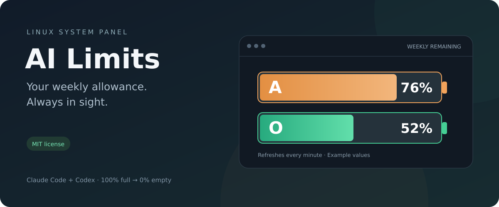

<p align="center"></p>

<p align="center">
  <a href="LICENSE"></a>
  <a href="https://github.com/Sportinger/ai-limits/actions/workflows/tests.yml"></a>
  
  
</p>

# AI Limits

**Your weekly AI allowance, at a glance.** Two little batteries in your Linux system panel show how much Claude Code and Codex usage you have left.

**A** is Anthropic, in orange. **O** is OpenAI, in green. Full means **100% remaining**; empty means **0%**. Both turn dark orange at **25%** and red at **10%**.

[Install](#install) · [How it works](#how-it-works) · [Troubleshooting](#troubleshooting) · [Deutsche Anleitung](README.txt)

## Small app, useful details

- Two proportional batteries with readable provider letters and percentages.
- Refreshes every minute while running; no terminal needs to stay open.
- Click to see weekly reset times, session limits when available, and connection status.
- Starts automatically when you log in. Choose **Beenden** to quit for the current session.
- Uses your existing CLI sign-ins. No model prompts, token-count estimates, or API billing key.
- Failed requests keep the last value **gray and marked `~`**. Unknown is `–`, never a fictional full battery.
- Backs off on errors and respects the provider's `Retry-After` response.

The interface is currently in German. Tested on **Ubuntu 26.04, GNOME 50.1, Wayland**. Other desktop environments have not been verified; wide tray images may render differently.

## Install

You need Python 3.11+, GTK 3, PyGObject, Ayatana AppIndicator, systemd user services, and a desktop with AppIndicator support. Ubuntu's GNOME session already includes a tray extension; on other GNOME installations enable an AppIndicator extension first.

Install the dependencies on Ubuntu:

```bash
sudo apt install git python3-gi gir1.2-gtk-3.0 \
  gir1.2-ayatanaappindicator3-0.1 desktop-file-utils
```

Sign in to the official **Codex CLI** and **Claude Code** using the subscriptions you want to monitor. Codex must be on your `PATH`. A missing sign-in is shown independently for each provider.

```bash
mkdir -p ~/Documents
git clone https://github.com/Sportinger/ai-limits.git ~/Documents/ai-limits
cd ~/Documents/ai-limits
./install.sh
```

The installer creates the application-menu entry, `~/.local/bin/ai-limits`, and `~/.config/systemd/user/ai-limits.service`. It enables the service for your graphical login and starts it immediately. Run it as your regular user, **without sudo**. Keep the checkout in place: the service runs directly from it.

For installation without service activation, use `./install.sh --no-start`.

## How it works

| Provider | Source | Weekly allowance |
| --- | --- | --- |
| OpenAI | Official `codex app-server`, `account/rateLimits/read` over stdio | The general Codex pool's 10,080-minute window, whether primary or secondary |
| Anthropic | `GET https://api.anthropic.com/api/oauth/usage` | The general `seven_day` allowance |

Codex handles its own authentication and renewal. Claude credentials are read from `~/.claude/.credentials.json`, or `CLAUDE_CONFIG_DIR`, on each poll. If Claude's sign-in expires, open Claude Code to renew it; the app does not rewrite its credential file.

These are **subscription allowance percentages, not remaining token counts**. Model-specific and shorter session limits can still apply. A 0% battery means the included weekly allowance is exhausted; separately enabled extra usage or credits may still allow work.

Anthropic's OAuth usage endpoint is not a guaranteed stable public API. Provider changes can require an update. See the [Codex app-server documentation](https://learn.chatgpt.com/docs/app-server) and [Claude Code status-line documentation](https://code.claude.com/docs/en/statusline) for the providers' usage fields.

## Privacy

Credentials stay in the existing CLI files. They are not copied into this project, cached, or logged. Claude's bearer token is sent only to its HTTPS usage endpoint; redirects are rejected. Codex's official CLI manages its network requests.

Only normalized percentages, reset times, and status are stored under `~/.cache/ai-limits`, with a private directory and `0600` state file. No conversation history is read. The app makes no inference requests, purchases no credits, and consumes no reset credits.

## Troubleshooting

| Symptom | What to check |
| --- | --- |
| No icon | Confirm AppIndicator support is enabled, then check the service log below. |
| Gray `~` battery | Open the menu for the last error. Network failures and throttling retry automatically. |
| Claude sign-in expired | Open Claude Code and sign in again if needed. The monitor rereads its credentials. |
| Codex unavailable | Check `codex --version` and the CLI's sign-in. The service needs Codex on its user `PATH`. |
| No weekly limit | The provider may not expose a weekly allowance for this account or plan. |

```bash
systemctl --user status ai-limits
journalctl --user -u ai-limits -n 30
python3 app.py --status  # Last stored reading; does not contact providers
python3 app.py --check   # One live request per provider; JSON, no secrets
```

Update from a clean checkout:

```bash
git pull --ff-only
./install.sh
systemctl --user restart ai-limits
```

Remove the installed service and launchers, keeping your CLI sign-ins:

```bash
systemctl --user disable --now ai-limits.service
rm ~/.config/systemd/user/ai-limits.service
rm ~/.local/bin/ai-limits
rm ~/.local/share/applications/ai-limits.desktop
systemctl --user daemon-reload
```

You can then delete the checkout and, optionally, `~/.cache/ai-limits`.

## Development

`limits.py` handles provider reads and battery rendering. `app.py` owns the GTK tray and refresh loop. `install.py` installs user-session integration. The offline tests use only the Python standard library:

```bash
python3 -m unittest discover -v
```

See [CONTRIBUTING.md](CONTRIBUTING.md) for checks and reporting issues. The preview uses example values, not an account screenshot.

## License

[MIT](LICENSE) · Copyright © 2026 Sportinger.

An independent community project, not affiliated with or endorsed by OpenAI or Anthropic. Provider names identify the services being monitored.
